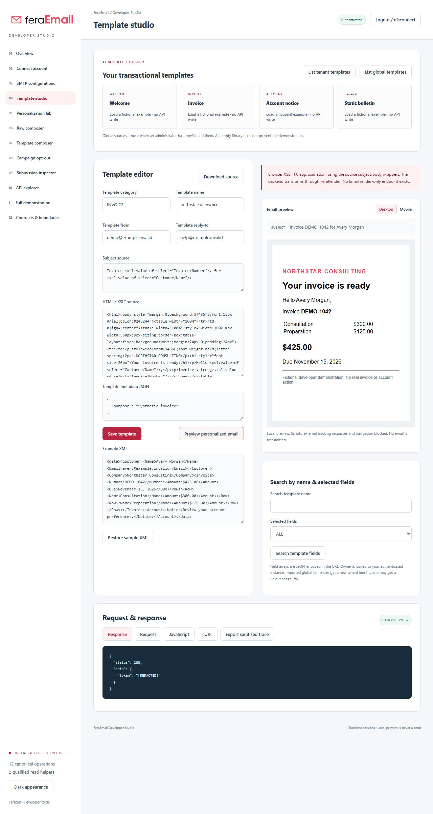

# FeraEmail Developer Studio

A complete standalone React/Vite and Express email operations console: SMTP profiles, tenant/global templates, XML/XSLT personalization, raw and template composers, safe inline attachments, campaign opt-out examples, submission inspection and the audited API explorer.

**No public deployment was performed. Sending is disabled by default.** Runtime responses always come from the configured APIs. Test fixtures are explicit and never replace a live failure. The project preserves the repository's existing MIT license and history.

## Start locally

Requires Node 22.12+ and npm.

```powershell
cd C:\Projects\Feradel\demo.feramail
npm ci
Copy-Item .env.example .env
# Configure the actual service origins and your authorized instance in .env.
npm run dev
# http://127.0.0.1:4180
```

For a built application: `npm run build`, then `npm start`. Windows helper: `powershell -File scripts/start.ps1`.

The verified local defaults are Auth 10443 and Email 10587. Remote origins require HTTPS and explicit `ALLOWED_API_URLS`. Optional `RENDER_API_URL` is empty by default. The app binds to loopback and rejects unapproved origins; it cannot target Matters API.

## Workspaces

- Connection and transient FerAuth session, including provisioned API-key accounts.
- SMTP manager with source-supported CRUD, write-only passwords, explicit credential replacement and no send-on-save.
- Split template library/editor, global import, name/field search, metadata and desktop/mobile sandboxed previews.
- Personalization laboratory using actual browser XSLT 1.0 and the backend's subject/body wrappers. Clearly labeled approximation; optional fixed FeraRender integration transforms without sending.
- Raw and template composers with recipient-specific confirmation, exact payload binding, bounded PNG/JPEG/PDF/text attachments, CID images and opt-out URLs.
- SMTP submission inspector distinguishing provider acceptance from final inbox delivery; no fabricated analytics or webhooks.
- Resumable Northstar walkthrough that captures real returned IDs, handles missing globals and never sends automatically.
- Generated canonical explorer, JavaScript/cURL examples, actual response inspection and metadata-only sanitized trace export.

## Contract coverage

|Source|Public|Internal|Aliases|
|---|---:|---:|---:|
|Email main `1763efd`|12 baseline|4 lifecycle|12 public + 4 lifecycle|
|Candidate `0eaca53`|12 baseline|5, including shared-owner provisioner|16 total; 33 callable contracts|
|Qualified release 83|12 baseline + 2 read helpers|5|14 public + 4 lifecycle|

All twelve canonical baseline operations are executable. Qualified send preflight and operation-receipt reads additionally require `EMAIL_RUNTIME_EXTENSIONS=true`. Internal lifecycle/shared-owner operations are documentation only. Legacy aliases and arbitrary proxy destinations cannot execute. Supplemental health is documented separately. Exact commits, hashes and source distinctions are in [inventory](docs/inventory.json) and [coverage](docs/coverage.md).

## Send policy

Composition and preview need no send permission. Actual submission needs authentication, backend licensed-product/permission approval, `SEND_ENABLED=true`, an exact `SEND_ACCOUNTS=instanceUUID:userUUID` entry, exact `RECIPIENT_ALLOWLIST`, an approved/session-created profile and approved SMTP destination. The operator sets policy outside the UI.

Every send uses a five-minute payload-bound challenge and typed `SEND recipient1, recipient2` confirmation. Maximum three combined To/CC/BCC recipients, five attempts per session, three attempts per tenant/recipient per hour, three attachments, 512 KiB per attachment, 1 MiB combined and 2 MiB JSON request limit. Paths, URLs, raw MIME and private/metadata SMTP hosts are denied. See [sandbox](docs/sandbox.md) for an isolated Mailpit configuration.

## Qualification

```powershell
npm run audit
npm test
npm run test:ui
npm run build
# Opt-in only, after authorized nonproduction configuration:
npm run smoke
```

Node tests exercise the actual proxy against isolated fixtures and pinned source functions. A separate source test runs the real qualified send service and actual Nodemailer against an in-memory loopback SMTP sink, verifies PDF/CID MIME and footer behavior, and never relays mail. That test skips on a standalone clone without the neighboring backend dependency; its captured local qualification is recorded in [qualification](docs/qualification.md).

Browser tests explicitly intercept API calls and exercise actual browser XML/XSLT and sandboxed preview rendering. No authenticated live account, real SMTP provider or remote rendering service was supplied. The opt-in smoke command refuses without nonproduction credentials; sending has its own additional opt-in and policy checks.

Two narrow backend fixes are prepared in a [separate draft PR](https://github.com/feradelinc/feradel.email.api/pull/2): preserve an omitted SMTP password and honor template field projection. They are not merged or deployed. The Studio's editor compensates for current behavior. Signed service owner scope and Matters integration are preserved.

## Screenshots

These screenshots show explicitly intercepted synthetic browser-test sessions, not production accounts.



[Overview](docs/screenshots/overview.png) · [Raw composer](docs/screenshots/raw-composer.png) · [Personalization](docs/screenshots/personalization.png) · [API explorer](docs/screenshots/api-explorer.png) · [Mobile](docs/screenshots/mobile.png)

## Documentation

[Developer guide](docs/developer-guide.md) · [Security/source findings](docs/backend-discrepancies.md) · [Qualification](docs/qualification.md) · [SMTP sandbox](docs/sandbox.md) · [Examples](examples/README.md) · [Optional hosting requirements](docs/hosting.md)
